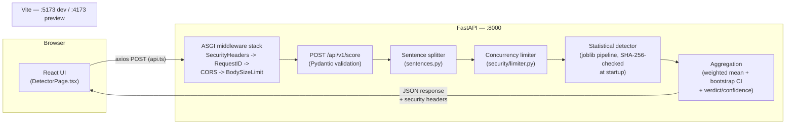

# AI Content Detector

Paste an English passage and get a sentence-level estimate of how likely
each sentence is to be AI-generated, plus a document-level score reported
with a 95% confidence interval — not a bare "yes/no".

## Who this is for

Teachers, tutors and editors who need a **first-pass screening signal** on
submitted text — not a verdict. The tool is built around that distinction
on purpose: every score ships with a confidence interval and a plain-
English band ("likely human-written" / "unclear" / "likely AI-generated"),
the UI states repeatedly that no detector of this kind is reliable
evidence of misconduct, and the [limitations](#known-limitations--next-steps)
section below is not boilerplate — read it before trusting any single
number this tool reports. The problem it solves is narrow and honest: *"is
this worth a closer human look?"*, not *"did a human write this?"*.

## Architecture



### Follow one request

A paste-and-analyse round trip, naming the exact file/function at each
step:

1. **Typing** — `frontend/src/pages/DetectorPage.tsx`'s `text` state;
   `validate()` checks length/whitespace on every keystroke and disables
   the button with an inline reason until the text is valid.
2. **Submit** — `analyse()` calls `scoreText()` in `frontend/src/api.ts`,
   an axios `POST` to `${VITE_API_BASE}/score`.
3. **ASGI middleware** (`backend/app/main.py`, `backend/app/security/`),
   outermost first — the last one `add_middleware()`d is the outermost on
   the way in, per Starlette's (Starlette, 2026) stacking order, which
   FastAPI uses directly: `SecurityHeadersMiddleware` → `RequestIDMiddleware`
   → `CORSMiddleware` → `BodySizeLimitMiddleware`. The last one stops
   reading the request body the instant it exceeds `MAX_BODY_BYTES`
   (64 KiB) and rejects with 413 *before* anything below it ever runs —
   see [Denial of Service](#defence-1--denial-of-service-advanced).
4. **Validation** — FastAPI routes to `score()`; the body is parsed into
   `ScoreRequest` (`backend/app/schemas.py`), which enforces character
   length bounds and rejects whitespace-only text. A validation failure
   here, or anywhere else in this list, becomes a `422`/`413`/`503` in the
   shared `{"error": {code, message, request_id}}` envelope (see
   [API](#api)) — never a raw exception.
5. **Normalisation** — `normalise_text()` (`backend/app/normalise.py`),
   the Section 2.8 detection-evasion defence: Unicode NFKC normalisation,
   then stripping invisible format characters and unresolved combining
   marks, then mapping a pinned confusables subset back to Latin. Runs on
   the whole passage before splitting, so the model only ever sees
   normalised text; disabled with `NORMALISE_INPUT=off` (see
   [Detection evasion](#advanced-attack--detection-evasion)).
6. **Splitting** — `split_sentences()` (`backend/app/sentences.py`) turns
   the *normalised* passage into sentences; `score()` rejects with 422 if
   the result exceeds `MAX_SENTENCES`. Each sentence's offsets are then
   translated back (`translate_span()`) into the *original* text the user
   pasted, so the UI highlights exactly what they see on screen even when
   normalisation changed what the model scored.
7. **Admission control** — `inference_limiter.slot()`
   (`backend/app/security/limiter.py`) bounds how many inferences run at
   once; beyond capacity, or past a queue timeout, the request fails fast
   with 503 + `Retry-After` rather than queuing indefinitely.
8. **Inference** — `_run_inference()` (`backend/app/main.py`) runs the
   detector's `score_sentences()` off the event loop via
   `anyio.to_thread.run_sync`, with a timeout backstop. The detector
   itself (`backend/app/detectors/statistical.py`) is loaded exactly once,
   at startup, behind a SHA-256 check against the committed model file.
9. **Aggregation** — `weighted_mean()` and `bootstrap_ci()`
   (`backend/app/aggregate.py`) produce the document score and its 95% CI;
   `band_for()`, `verdict_for()` and `confidence_for()`
   (`backend/app/schemas.py`) turn the score into the banded wording,
   binary verdict and confidence the UI displays.
10. **Response** — `ScoreResponse` is serialised and the security headers
    are added on the way back out through the same middleware stack.
11. **Rendering** — `DetectorPage.tsx` stores the result and moves focus to
    `components/VerdictCard.tsx` (verdict, confidence, CI, band),
    announced via an `aria-live` region; `components/SentenceChart.tsx` and
    `components/HighlightedText.tsx` render the per-sentence breakdown,
    linked so hovering one highlights the other;
    `components/SessionHistoryChart.tsx` adds the result to this session's
    comparison chart.

## Run it

**Tested with Python 3.13.13.** Node: `frontend/package.json`'s
`engines.node` requires `>=20.19.0`; tested on v26.13.0 and on Node 22 LTS
(v22.23.4) — both installs, builds and lints cleanly (the backend works
on anything Python ≥3.11, but the pinned dependency versions below were
resolved against 3.13).

Backend:

```bash
cd backend
python3 -m venv ../.venv
../.venv/bin/pip install -r requirements.txt
../.venv/bin/uvicorn app.main:app --port 8000 --no-server-header
```

`--no-server-header` is not optional — see
[Misconfiguration](#defence-2--misconfiguration--vulnerable-dependencies-intermediate).
Never add `--reload` or run with debug enabled outside local development;
neither appears in this command for a reason.

This installs only the runtime dependencies for the default `statistical`
detector (no download, no GPU). Other dependency groups are layered on top
when needed — see [Pinned dependencies](#pinned-dependencies).

Frontend:

```bash
cd frontend
npm ci
npm run dev   # http://localhost:5173 (fixed port; see vite.config.ts)
```

Copy `backend/.env.example` to `backend/.env` and `frontend/.env.example`
to `frontend/.env.local` if you need to override any default (see
[Environment variables](#environment-variables)); neither file is required
to run the app as described above.

By default the backend serves every request with the locally trained
statistical model. Setting `AIDETECT_ENABLE_HF=1` (after installing
`requirements-optional.txt`) opts into the pretrained RoBERTa transformer
instead — `Hello-SimpleAI/chatgpt-detector-roberta` (Guo et al., 2023);
the first request then downloads its weights (~500 MB), and if
that fails (offline), the statistical model answers instead and the UI
says so.

### Tests

```bash
cd backend
../.venv/bin/pip install -r requirements.txt -r requirements-dev.txt
../.venv/bin/pytest tests/ -q

cd ../frontend
npm ci
npx playwright install chromium
npm run build && npm run lint
npx playwright test
```

One backend test (`test_preprocessing_parity.py`'s training-pipeline
check) is skipped unless `requirements-train.txt` is also installed; it
still runs whenever the full set is present, as it already is on any
machine that has also run the ML pipeline below. The Playwright suite
starts both servers itself (see `frontend/playwright.config.ts`).

## Machine-learning pipeline (Assignment 2)

All commands run from the repository root unless stated otherwise. This
pipeline — and the statistical model it produces — is Assignment 2 work
and is unchanged here; see [docs/EVALUATION.md](docs/EVALUATION.md) for
the full evaluation and its limitations.

**1. Environment (conda)**

```bash
conda env create -f environment.yml
conda activate cos30049
```

**2. Data processing** (`dataprep/data_prep.py`). Place the raw files
first: DAIGT v2 `train_v2_drcat_02.csv` (Kaggle `thedrcat/daigt-v2-train-dataset`;
Kłeczek, 2023) in `dataprep/archive/`, and HC3 `all.jsonl` (Hugging Face
`Hello-SimpleAI/HC3`; Guo et al., 2023) in `dataprep/`.
The processed dataset is shipped as `dataprep/merged_dataset.csv.zip`.
To skip step 2, unzip it in place so that `dataprep/merged_dataset.csv` exists:

    cd dataprep && unzip merged_dataset.csv.zip && cd ..

```bash
python dataprep/data_prep.py            # writes dataprep/merged_dataset.csv (+ EDA plots)
python dataprep/data_prep.py --skip-eda # same, without plots
```

The merged file has one row per document with columns `text, label (0=human,
1=AI), source (DAIGT_v2 | HC3), topic, group, generator, generator_family`.

**3. Train and compare models** (`backend/ml/train.py`)

```bash
cd backend
python -m ml.train                  # full run (tens of minutes); writes models/
python -m ml.train --fast           # ~10x smaller smoke test; writes ml/_smoke/ only
python -m ml.evaluate_hf 8000       # pretrained RoBERTa on the same test sentences
python -m ml.train --table-only     # add the RoBERTa row to models/model_comparison.md
```

Outputs in `backend/models/`: `final_model.pkl` (selected model),
`statistical_model.meta.json` (metrics, selection criterion),
`model_comparison.md/json` (all models, three evaluation protocols). The exact
sentences used are saved in `backend/ml/data/train_split.jsonl` and
`test_split.jsonl`.

After a real (non-`--fast`) retrain, also regenerate the hash the backend
checks at startup, and commit it alongside the new model file:

```bash
python scripts/hash_model.py   # from the repository root; writes statistical_model.sha256
```

**4. Predict with the trained model**

```bash
cd backend
python -m ml.predict "Furthermore, it is important to note that this is a test. lol idk man."
python -m ml.predict --file essay.txt
```

Or start the web app (see [Run it](#run-it) above): `POST /api/v1/score`.

**5. Clustering, held-out evaluation and feature EDA** (`backend/ml/`)

Both scripts read `dataprep/merged_dataset.csv`, the same file used to train the
final model (unzip `dataprep/merged_dataset.csv.zip` first, see step 2).

```bash
cd backend/ml
python cluster_and_eval.py     # several minutes: K-Means + two retrainings
python eda_features.py         # about 1-2 minutes
```

`cluster_and_eval.py`:
- clusters the AI-generated documents with K-Means on the ten stylometric
  features (`StandardScaler`, K = 2-8 compared by elbow and silhouette, K = 6 kept),
  prints each cluster's size, distinctive features and the document closest
  to its centre, and saves `elbow_plot.png`;
- runs the held-out generator test: the final model configuration from
  `ml/train.py` is trained once with and once without the Mistral family and
  both are scored on the same balanced human/Mistral test sentences. Metrics
  are saved to `heldout_family_mistral.json` and eight random false positives
  and false negatives are printed for error analysis (seed 42).

`eda_features.py` compares the 20 stylometric and discourse features on
10,000 human and 10,000 AI texts and saves `eda_feature_differences.png` and
`eda_feature_summary.csv`. Another dataset path can be passed as an argument:
`python eda_features.py path/to/file.csv`.

`holdout_daigt_full_hc3model.json` and `holdout_daigt_sentences_hc3model.json`
are results of an earlier test with the HC3-only model, kept for reference.

## Pinned dependencies

`backend/requirements.txt` pins exact runtime versions for the default
install (FastAPI + the statistical detector). Everything else is layered on
top of it, installed only where it is actually needed:

| File | Adds | Needed for |
|---|---|---|
| `requirements.txt` | `fastapi==0.141.1`, `uvicorn[standard]==0.52.4`, `pydantic==2.13.4`, `numpy==2.4.6`, `scikit-learn==1.9.0`, `joblib==1.5.3`, `anyio==4.14.2` | running the API (always) |
| `requirements-dev.txt` | `pytest`, `httpx`, `pip-audit` | running tests, dependency auditing |
| `requirements-train.txt` | `pandas`, `xgboost`, `matplotlib`, `datasets` | `backend/ml/*` scripts |
| `requirements-optional.txt` | `torch`, `transformers` | `AIDETECT_ENABLE_HF=1` |

Frontend (`frontend/package.json`), versions exact (no `^`/`~`), matching
`package-lock.json` — always install with `npm ci`, never `npm install`,
so the lockfile is never silently rewritten:

| Package | Version |
|---|---|
| react, react-dom | 19.2.8 |
| react-router-dom | 7.18.5 |
| @mui/material, @mui/icons-material | 9.3.1 |
| @emotion/react, @emotion/styled | 11.14.0 / 11.14.1 |
| recharts | 3.10.1 |
| axios | 1.21.0 |
| vite | 8.3.6 |
| typescript | 6.0.3 |
| @playwright/test, @axe-core/playwright (dev) | 1.65.0 / 4.14.0 |

## API

`POST /api/v1/score` `{"text": "..."}` → sentence scores (+offsets, bands),
a document score with a 95% CI, a binary `verdict` (`ai-generated` /
`human-made`) and `confidence`, and `meta` describing which detector
answered. `GET /api/v1/health` → active + available methods, never queued
behind inference. `GET /api/v1/model-info` → model identity,
training/evaluation summary, band thresholds and input limits. Interactive
docs with request/response examples at `http://localhost:8000/docs`.

Every error response shares one shape:
`{"error": {"code": "SNAKE_CASE", "message": "...", "request_id": "..."}}`.
`request_id` matches the `X-Request-ID` response header and the
corresponding server-side log line (the traceback itself is logged, never
returned).

## Environment variables

| Variable | Effect |
|---|---|
| `FRONTEND_ORIGIN` | CORS allow-list origin (default `http://localhost:5173`) |
| `SECURITY_DEFENCES` | `off` disables the body-size limit, sentence cap, concurrency limiter and security headers — **demo only, see [Denial of Service](#defence-1--denial-of-service-advanced)** |
| `AIDETECT_METHOD` | Force one method (`hf-transformer`, `statistical`, `mock`) |
| `AIDETECT_ALLOW_MOCK` | `1` adds the mock to the end of the fallback chain |
| `AIDETECT_ENABLE_HF` | `1` opts into the pretrained transformer (needs `requirements-optional.txt`) |
| `AIDETECT_HF_MODEL` | Override the HuggingFace model id |
| `AIDETECT_MIN_TEXT_CHARS` / `AIDETECT_MAX_TEXT_CHARS` | Input length bounds (default 20 / 12,000) |
| `AIDETECT_MAX_SENTENCES` | Max sentences per request (default 300) |

See `backend/.env.example` and `frontend/.env.example`.

## Threat model

**Who attacks this.** Three realistic actors: (1) **a student (or similar)
whose own writing is being screened**, motivated to get an AI-generated
submission judged human-made, or conversely to get a human submission
flagged to discredit the tool; (2) **a content farm or SEO operator**,
running large volumes of generated text through the public endpoint to
calibrate how to defeat it, or to build a competing detector from the
responses; (3) **an opportunistic prober** — automated scanners and casual
attackers who hit any public HTTP endpoint looking for generic
misconfiguration, outdated dependencies, or a cheap denial-of-service
target, with no specific interest in this app.

**What they want.** Evading detection (actor 1), harvesting the model's
behaviour at scale or degrading service for other users while doing so
(actor 2), and opportunistic compromise or disruption (actor 3) — getting
AI text classified as human-made, making the service slow or unavailable
for everyone else, or finding a foothold via a known CVE or a missing
header.

**What they can do.** Everything is reachable over plain HTTP to a public
endpoint with no authentication: direct, scripted calls to `POST
/api/v1/score` (not just through the UI); unlimited repeated queries to
probe the model's decision boundary; Unicode look-alike and invisible-
character tricks embedded in submitted text (Section 2.8, see
[Detection evasion](#advanced-attack--detection-evasion)); and bodies or
request volumes shaped to be expensive rather than merely large (Section
2.7, see [Denial of Service](#defence-1--denial-of-service-advanced)).
Nothing in this app distinguishes a browser-driven request from a
scripted one, by design — the API is the actual product surface, the UI
is one client of it.

**Which Section 2.7 risks apply, and why the others do not** (risk names
follow the OWASP Top Ten; OWASP, 2021):

| Risk | Applies? | Reason |
|---|---|---|
| Denial of Service | **Yes — marked, Advanced** | The only endpoint that does real work (`/score`) is a public, unauthenticated POST; see below. |
| Misconfiguration & vulnerable dependencies | **Yes — marked, Intermediate** | Headers, dependency pins and `/docs` exposure are exactly the kind of thing a generic scanner (and `npm audit`/`pip-audit`/ZAP) checks for; see below. |
| SSRF | No | The backend never makes an outbound request based on user input — no URL, hostname or file path in `ScoreRequest` is ever fetched, opened or proxied; the only outbound call the whole system can make (downloading HF transformer weights) is gated behind an operator-set environment variable, never user input. |
| Command injection | No | User text is never passed to a shell, a subprocess, or any `eval`/`exec`-like construct; it is only tokenised, hashed and vectorised by library code that treats it as opaque data. |
| SQL injection | No | There is no database and no SQL anywhere in the stack — the model is a joblib file loaded from a fixed, hash-checked path, and the only persistent state (session history) lives client-side in the browser. |
| File upload | No | No endpoint accepts a file; `ScoreRequest` is a single bounded string field. |
| Broken access control | No *(by design, not by oversight)* | The app has no authentication, no user accounts and no per-user data — there is no access boundary to break. If this were ever deployed with accounts or saved history, this row would need to be revisited. |

## Security hygiene checklist

- **No HTML injection.** User text is only ever rendered as React text
  nodes (`{text}`), never `dangerouslySetInnerHTML`; grep the front end
  for that string to confirm it does not appear.
- **Bounded input, every dimension.** Text length (`MIN_TEXT_CHARS`/
  `MAX_TEXT_CHARS`), sentence count (`MAX_SENTENCES`) and raw request body
  size (`MAX_BODY_BYTES`, enforced before the body is even fully read) are
  all capped independently — see [Denial of Service](#defence-1--denial-of-service-advanced).
- **One exact CORS origin.** `allow_origins=[FRONTEND_ORIGIN]`, methods
  limited to GET/POST, headers limited to Content-Type, no credentials —
  never a wildcard.
- **No secrets in this app.** There is no database, no third-party API key
  and no credential of any kind in the current deployment; the `.env`
  files only configure origins and numeric limits. If a secret is ever
  introduced, it belongs in an untracked `.env` file, never a committed
  one — `backend/.env.example` and `frontend/.env.example` are templates,
  not real values.
- **Model integrity checked at startup.** The statistical model's SHA-256
  is verified against `backend/models/statistical_model.sha256` before it
  is loaded; a mismatch or missing hash refuses to start the server rather
  than silently serving an unverified pickle (pickle files can execute
  arbitrary code on load — see [Design decisions](#design-decisions) for
  why this, rather than some other format, is the real reason the check
  exists).
- **Security headers on every response, including errors.** See
  [Misconfiguration](#defence-2--misconfiguration--vulnerable-dependencies-intermediate).
- **Dependencies pinned and audited**, not left to float — see
  [Pinned dependencies](#pinned-dependencies) and the misconfiguration
  defence below.

## Defence 1 — Denial of Service (Advanced)

**Mechanism.** `measure_cost.py` measures `/score`'s real cost first: a
request at the enforced limits (12,000 chars / 300 sentences) costs
~130ms, almost all of it model inference; nothing is bounded past that —
at 250,000 characters, one request costs 2.6s and 129MB. Three defences in
`backend/app/security/`, all gated by `SECURITY_DEFENCES` (default on):

- **`body_limit.py`** — a raw-ASGI middleware that rejects a request the
  instant it is provably too large (declared `Content-Length`, or a
  running total while streaming), before the body is ever handed to the
  app, covering chunked transfer and a false `Content-Length` alike.
- **Sentence-count cap** (`MAX_SENTENCES`, enforced in `app/main.py`) —
  rejects before inference runs, closing the gap where a body under the
  character limit can still pack thousands of one-word "sentences".
- **`limiter.py`** — bounds concurrent inference to `MAX_CONCURRENT_INFERENCES`
  (2) running + `MAX_QUEUED_INFERENCES` (8) queued; beyond that, or past
  `QUEUE_TIMEOUT_S`, an immediate 503 with `Retry-After` instead of
  unbounded queuing. Inference itself runs off the event loop
  (`anyio.to_thread.run_sync`), so `/health` stays responsive throughout.

A real ReDoS bug turned up auditing the sentence splitter's regex for
catastrophic backtracking (a possessive, bounded quantifier fixed it —
340ms/1.3s down to under 4ms on a 12,000-char adversarial input).

**Reproduction:**

```bash
cd backend && ../.venv/bin/uvicorn app.main:app --port 8000 &
python ../security/dos/measure_cost.py
python ../security/dos/expensive_request.py --scenario sentence-flood --label defences_on
python ../security/dos/flood.py -n 200 --label defences_on

SECURITY_DEFENCES=off ../.venv/bin/uvicorn app.main:app --port 8000 &
python ../security/dos/expensive_request.py --scenario sentence-flood --label defences_off
python ../security/dos/flood.py -n 200 --label defences_off
```

**Results** (200 concurrent legitimate-sized requests; full detail and
plots in `security/dos/README.md`, `security/dos/results/`):

| | Status codes | Latency (served requests) |
|---|---|---|
| Defences **on** | 32× 200, 168× 503 | p50 737ms, p95 855ms |
| Defences **off** | 200× 200 | p50 2,155ms, p95 3,867ms |

**Cost.** Legitimate users can receive a 503 under genuine load (capacity
is 10 in-flight requests at a time); the queue timeout (2s) trades off
how long a queued client waits against how many brief-spike requests get
served at all. See `security/dos/README.md` for the full write-up.

## Defence 2 — Misconfiguration & vulnerable dependencies (Intermediate)

**Mechanism.** `backend/app/security/headers.py` adds
`X-Content-Type-Options`, `Referrer-Policy`, `X-Frame-Options`,
`Content-Security-Policy`, `Permissions-Policy` and
`Cross-Origin-Resource-Policy: same-origin` to every response, including
413/422/500; `/docs` gets a deliberately looser CSP for Swagger UI's CDN
resources, `/score` gets `Cache-Control: no-store`, and `/redoc` is
disabled outright rather than given a third CSP allowance for a page that
only duplicates `/docs`. `vite.config.ts` mirrors the same headers for the
front end. `uvicorn --no-server-header` removes the `Server: uvicorn`
banner. Vulnerable dependencies (axios, vite and their transitive
advisories) were upgraded, not just flagged.

**Reproduction:**

```bash
../.venv/bin/python -m pip_audit -r backend/requirements.txt
cd frontend && npm audit && npm audit --omit=dev
cd ../backend && ../.venv/bin/uvicorn app.main:app --port 8000 --no-server-header &
../security/misconfig/demo_headers.sh
```

OWASP ZAP (OWASP ZAP, 2026; needs Docker) commands are in
`security/misconfig/FINDINGS.md`, which also has the full per-alert table.

**Results:**

| Check | Before | After |
|---|---|---|
| `npm audit` (all) | 4 packages, 24 advisories | **0** |
| `pip-audit` | clean | clean |
| ZAP, API — alerts at Low risk or above | 2 | **0** (`WARN-NEW 0, PASS 120, 0 FAIL`) |
| ZAP, front end — alerts at Low risk or above | 8 | **3**, all justified (`style-src unsafe-inline`, COEP, a Timestamp Disclosure false positive — see `FINDINGS.md`) |

**Cost.** A strict CSP constrains future features — any new third-party
script/font/widget needs an explicit directive change, and the policy
fails closed by design. One round of this work chose
`Cross-Origin-Resource-Policy: same-site` from a genuinely incorrect read
of what that header checks: per the Fetch Standard (WHATWG, 2026), CORP's
check only applies to a `no-cors`-mode request, never to the CORS-mode
`fetch`/XHR calls axios makes, so `same-origin` is both stricter and
correct here (full account, including why, in
`security/misconfig/FINDINGS.md`) — a concrete reminder that "looks
plausible for the deployment shape" is not the same as checking what a
header's check actually does.

## Advanced attack — Detection evasion

**Mechanism.** Section 2.8: a correctly-detected AI-generated sentence,
rewritten with Unicode tricks that leave it visually near-identical but
change the exact character sequence the model tokenises — homoglyphs
(Cyrillic/Greek look-alikes), invisible format characters, fullwidth
forms, and combining-mark ("Zalgo") stacking. `backend/app/normalise.py`
defends against this: NFKC normalisation, then stripping any invisible
characters and combining marks NFKC did not resolve, then mapping a
pinned Unicode TR39/UTS #39 confusables subset (Unicode Consortium, 2024)
back to Latin — run before
sentence-splitting and scoring, with offsets translated back to the
user's own text so highlighting still lines up (see the
[request walkthrough](#follow-one-request) above). Toggled with
`NORMALISE_INPUT=off`, mirroring `SECURITY_DEFENCES`.

**Reproduction:**

```bash
python security/evasion/run_experiment.py   # 1,000 trials/condition, offline
python security/evasion/plot_results.py     # security/evasion/results/evasion_rates.png
python security/evasion/measure_cost.py     # accuracy/latency/Vietnamese-text cost

cd backend && NORMALISE_INPUT=off ../.venv/bin/uvicorn app.main:app --port 8000 --no-server-header
python security/evasion/live_attack.py --label undefended
# restart without NORMALISE_INPUT (default: on), then:
python security/evasion/live_attack.py --label defended
```

**Results** (full per-technique table and methodology in
`security/evasion/REPORT.md`):

| Technique @ rate (1,000 trials each) | Undefended | Defended |
|---|---|---|
| Homoglyph @ 50% | 341/1000 (34.1%) | 0/1000 (0.0%) |
| Invisible @ 50% | 678/1000 (67.8%) | 0/1000 (0.0%) |
| Fullwidth @ 50% | 489/1000 (48.9%) | 0/1000 (0.0%) |
| Combining-mark ("Zalgo") @ 50% | 680/1000 (68.0%) | 302/1000 (30.2%) |
| Mixed @ 50% | 810/1000 (81.0%) | 194/1000 (19.4%) |
| Live, through the real HTTP API, `mixed` @ 25% (30 attempts) | 16/30 (53.3%) | 4/30 (13.3%) |

Homoglyph, invisible and fullwidth are fully closed at **every** rate
tested (10/25/50%), not only at 50% — the 50% row is shown because it is
each technique's strongest attempt; see `security/evasion/REPORT.md`'s
full table for all three rates.

**Cost.** Over the full 14,556-sentence held-out test set, the defence
costs **zero** measured accuracy on clean text (0.9005 either way) and
negligible latency (p50 0.08ms, p95 0.36ms, against a ~130ms request
budget); 10 genuine Vietnamese sentences come through unchanged. The
combining-mark attack is only partially defended — not a bug, but a real
trade-off: NFKC recomposes a base letter plus a combining mark into its
precomposed Unicode form whenever one exists (the same mechanism that
correctly restores Vietnamese diacritics), but for common vowel+accent
pairs that precomposed letter is a real character the English training
vocabulary never contains, so it still reads as unfamiliar to the model
even though normalisation "worked". Closing this fully would mean
stripping every combining mark unconditionally — which would also break
genuine Vietnamese text. Full account — including a real coverage gap
this evaluation found and fixed in the pinned confusables table, and a
real sampling bug in the live-attack script that was inflating its
success rate for reasons unrelated to the defence, investigated and
fixed rather than left unexplained — in `security/evasion/REPORT.md`.

## Design decisions

- **Statistical model (TF-IDF + stylometric logistic regression) is the
  default, not the pretrained RoBERTa transformer.** The alternative
  considered was keeping the transformer as primary (Assignment 2's
  original framing, when it was evaluated only on HC3). It was rejected
  for a measured reason, not only a clean-install one: evaluated again on
  the larger, merged DAIGT_v2 + HC3 test set (14,556 sentences,
  `backend/models/model_comparison.md` and `hf_eval.json`), the
  statistical model is **more** accurate overall, not less — accuracy
  0.9005 vs 0.8017, F1 0.905 vs 0.823, ROC AUC 0.965 vs 0.905. The
  transformer only wins on the HC3 half of that set (AUC 0.999 there);
  on the DAIGT_v2 half it is markedly weaker (AUC 0.754), which the
  original HC3-only evaluation in `docs/EVALUATION.md` could not reveal.
  It also happens to need no `torch`/`transformers` install (a
  multi-hundred-MB dependency) or ~500MB weights download, so a grader
  following this README from a fresh clone gets the better-measured
  model *and* the lighter install. The transformer remains available,
  opt-in, via `AIDETECT_ENABLE_HF=1`.
- **Stylometric features sit alongside TF-IDF, not instead of it**
  (`backend/app/detectors/features.py`). Function-word frequencies
  (articles, prepositions, pronouns) are a standard, topic-independent
  authorship-attribution signal going back to Mosteller and Wallace's
  (1964) *Federalist Papers* authorship study; the Flesch (1948)
  reading-ease formula is one of the readability features in the same
  module. TF-IDF n-grams alone capture lexical fingerprints but not this
  kind of structural style.
- **The model is loaded once in `lifespan`, behind a SHA-256 check, not
  lazily per request.** The alternative — load on first use, as the
  original design did — was rejected because a `joblib`/pickle file can
  execute arbitrary code when deserialised; verifying its hash matches a
  committed, reviewed value *before* that deserialisation happens is the
  actual security property, not a performance optimisation. Loading once
  at startup (rather than re-checking per request) was then a free
  consequence, not the original motivation.
- **Bootstrap confidence interval, not a normal-approximation interval.**
  Sentence scores are bounded in [0, 1] and often bimodal (a half-human,
  half-AI document clusters near both ends), which a Gaussian
  standard-error interval fits poorly and can push outside [0, 1]; the
  percentile bootstrap makes no distributional assumption and its
  interval is always within the observed score range.
- **Inference runs off the event loop via `anyio.to_thread.run_sync`, not
  a plain synchronous `def` endpoint.** A plain sync endpoint is still
  dispatched to a worker thread by FastAPI, but `/health` would then share
  that same thread pool with `/score` and could queue behind an expensive
  request. Explicitly offloading only the CPU-bound inference step, and
  keeping `/health` as a plain `async def`, decouples the two — proven in
  `backend/tests/test_offload_and_timeout.py`, which asserts `/health`
  responds in under 300ms while a deliberately slow `/score` call is still
  in flight.
- **One error envelope for every failure mode**
  (`{"error": {code, message, request_id}}`), rather than letting
  FastAPI's (FastAPI, 2026) default validation error shape leak through.
  A consistent, machine-
  parseable shape is what let the front end map 413/422/503 to specific,
  actionable UI text instead of a generic "something went wrong".
- **Exactly one CORS origin, not a wildcard or regex.** The original
  prototype matched any `localhost` origin (Vite's default port-bumping
  behaviour). Pinning `FRONTEND_ORIGIN` to one exact value, and `vite.config.ts`
  to a `strictPort` fixed port, trades a small amount of dev convenience
  for a CORS policy that means what it says.
- **Why these specific limits.** `MAX_TEXT_CHARS=12,000` (~2,000 words) is
  comfortably above a multi-paragraph essay while bounding per-request
  cost (measured in `security/dos/results/`); `MAX_SENTENCES=300` and
  `MAX_BODY_BYTES=64 KiB` close the two gaps a character limit alone
  leaves open — many short sentences, and a body that is large before it
  is ever parsed. None of the three is arbitrary; each is justified by a
  measured cost curve, not a round number picked by feel.

## Known limitations & next steps

- **The detection-evasion defence has three known, measured limits**
  (full account in `security/evasion/REPORT.md`):
  - **Combining-mark ("Zalgo") attacks are only partly defended** — at
    50% perturbation (1,000 trials), the undefended rate is 68.0%
    (680/1000) and the defended rate is 30.2% (302/1000), not 0%. This is
    because NFKC recomposes a base letter plus a combining mark into its
    precomposed Unicode form whenever one exists — the same mechanism
    that correctly restores genuine Vietnamese diacritics — but for
    common vowel+accent pairs that precomposed letter is a real character
    the English training vocabulary never contains, so it still reads as
    unfamiliar to the model even after normalisation. Closing this fully
    would mean stripping every combining mark unconditionally, which
    would also break genuine Vietnamese text.
  - **The confusables table only covers a pinned subset.** It is ~72
    Cyrillic/Greek entries drawn from the official Unicode TR39/UTS #39
    confusables data (`security/evasion/data/confusables.txt`), not the
    full dataset — a homoglyph from a script outside that subset would
    not be caught.
  - **Paraphrasing and human editing are out of scope** and still defeat
    this detector, same as the limitations already documented in
    `docs/EVALUATION.md` for the underlying model generally.
- **English only**; other languages produce meaningless scores (stated in
  the UI's limitations panel).
- **Fairness.** Published work shows detectors of this kind over-flag
  non-native English writing (Liang et al., 2023); nothing in this
  training pipeline corrects for that, and the UI's limitations panel
  states it (see also `docs/EVALUATION.md`).
- **Short texts are unreliable** — the API warns below 3 sentences / 30
  words, but still returns a (wide-interval) score rather than refusing.
- **No persistence, no accounts.** Session history lives only in the
  browser tab that produced it; there is no way to share or revisit a
  result from another device. This is a deliberate scope boundary (see
  [Threat model](#threat-model)'s broken-access-control row), not an
  oversight, but would need real design work if accounts were ever added.
- **No automated dependency-update pipeline.** `pip-audit`/`npm audit` are
  run and documented by hand here (see
  [Misconfiguration](#defence-2--misconfiguration--vulnerable-dependencies-intermediate));
  a real deployment would want these in CI, scheduled, not just run once
  for this submission.
- **Single-process deployment assumed.** The concurrency limiter and the
  model's startup hash check are both process-local; running multiple
  backend instances behind a load balancer would need the limiter's
  capacity reasoned about per-instance (fine) but would duplicate the
  model-loading cost per instance (acceptable at this model's size, but
  worth noting).

## References

- FastAPI (2026) *FastAPI documentation*. Available at: https://fastapi.tiangolo.com/
  (Accessed: 7 November 2026).
- Flesch, R. (1948) 'A new readability yardstick', *Journal of Applied
  Psychology*, 32(3), pp. 221–233.
- Guo, B., Zhang, X., Wang, Z., Jiang, M., Nie, J., Ding, Y., Yue, J. and
  Wu, Y. (2023) 'How close is ChatGPT to human experts? Comparison
  corpus, evaluation, and detection', arXiv preprint arXiv:2301.07597.
- Kłeczek, D. (2023) *DAIGT V2 Train Dataset* [Dataset]. Kaggle.
  Available at: https://www.kaggle.com/datasets/thedrcat/daigt-v2-train-dataset
  (Accessed: 7 November 2026).
- Liang, W., Yuksekgonul, M., Mao, Y., Wu, E. and Zou, J. (2023) 'GPT
  detectors are biased against non-native English writers', *Patterns*,
  4(7), 100779.
- Mosteller, F. and Wallace, D.L. (1964) *Inference and Disputed
  Authorship: The Federalist*. Reading, MA: Addison-Wesley.
- OWASP (2021) *OWASP Top Ten*. Available at: https://owasp.org/www-project-top-ten/
  (Accessed: 7 November 2026).
- OWASP ZAP (2026) *ZAP documentation*. Available at: https://www.zaproxy.org/docs/
  (Accessed: 7 November 2026).
- Starlette (2026) *Starlette documentation*. Available at: https://www.starlette.io/
  (Accessed: 7 November 2026).
- Unicode Consortium (2024) *UTS #39: Unicode Security Mechanisms*.
  Available at: https://www.unicode.org/reports/tr39/ (Accessed: 7 November 2026).
- WHATWG (2026) *Fetch Standard*. Available at: https://fetch.spec.whatwg.org/
  (Accessed: 7 November 2026).

## Use of generative AI

*(Placeholder — to be completed by the team. State here, per the unit's
requirements, which parts of this submission, if any, were produced or
assisted by a generative AI tool, and how.)*

## Team and contributions

*(Placeholder — to be completed by the team: names, student IDs, and each
member's contribution.)*
