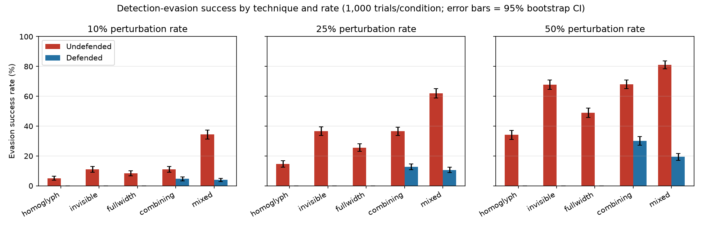

# Detection evasion (Section 2.8)

Advanced attack and defence: can Unicode character substitution make the
detector misread AI-generated text as human-made, and does normalising
the input before scoring stop it? Every number below is read from a
committed result file produced by the scripts in this directory —
`results/experiment.json`, `results/cost.json`,
`results/live_attack_undefended.csv`, `results/live_attack_defended.csv`
— not estimated or rounded from memory.

## The attack

Four techniques, each implemented in [`perturb.py`](perturb.py), at three
intensities (10/25/50% per eligible character) and a `mixed` combination
of all four:

- **homoglyph** — swaps a Latin letter for a Cyrillic or Greek look-alike,
  drawn from the exact pinned table the defence checks against (see
  [Scope](#scope-and-known-limitations) below for why that is a
  deliberate choice, not an oversight).
- **invisible** — inserts a zero-width/format character (Unicode category
  Cf) after a letter or digit.
- **fullwidth** — replaces a printable ASCII character with its fullwidth
  compatibility form.
- **combining** — appends an extra combining diacritic ("Zalgo" text) to
  a letter.
- **mixed** — all four, applied in sequence, each independently at the
  same rate.

None of these change what a human reader sees on screen (or change it
only cosmetically); all of them change the exact character sequence the
statistical model's TF-IDF vectoriser tokenises, which is what makes them
an evasion technique rather than legitimate text variation.

## The defence

[`backend/app/normalise.py`](../../backend/app/normalise.py): runs
Unicode NFKC normalisation, strips any remaining invisible format
characters and combining marks NFKC did not resolve, then maps a pinned
~72-entry subset of the official Unicode TR39 confusables data back to
its Latin skeleton. It runs before sentence-splitting and scoring, with
the response's sentence offsets translated back to the user's own
original text so highlighting still lines up on screen (see
`README.md`'s request walkthrough). Toggled with `NORMALISE_INPUT=off`
(demo only, mirroring `SECURITY_DEFENCES`).

## Methodology

[`run_experiment.py`](run_experiment.py) draws its test sentences from
`backend/ml/data/test_split.jsonl` — the exact held-out test set the
statistical model was evaluated against for Assignment 2 — restricted to
AI-generated (`label=1`) sentences the **clean, unperturbed** model
already scores correctly (≥ 0.5). This is the realistic attacker's
starting point: text a detector would otherwise flag, which they now want
to read as human-made. 6,868 of the 7,308 AI-labelled test sentences
≥ 20 characters met this bar; a fixed sample of 1,000 was drawn once
(seed `20261106`) and reused for every technique/rate combination, so
differences between conditions reflect the technique, not which
sentences happened to be sampled.

Each of 5 seeds perturbs 200 of those 1,000 sentences (1,000 trials per
condition in total) and scores the result twice — once as the attacker
would send it, once through `normalise_text()` first — directly against
the loaded statistical model (no HTTP, for speed at this volume;
[`live_attack.py`](live_attack.py), below, repeats a smaller version of
the same test through the real running API). "Evaded" means the verdict
flips to `human-made` (score drops below 0.5). The 95% CI is a 2,000-
resample bootstrap over the 1,000 binary outcomes, the same method
`app.aggregate.bootstrap_ci` uses for the product's own confidence
intervals.

```
python security/evasion/run_experiment.py
python security/evasion/plot_results.py   # security/evasion/results/evasion_rates.png
```

## Results — offline, 1,000 trials per condition



| Technique | Rate | Undefended: k/N (rate, 95% CI) | Defended: k/N (rate, 95% CI) |
|---|---|---|---|
| homoglyph | 10% | 51/1000 (5.1%, 3.8–6.4%) | 0/1000 (0.0%) |
| homoglyph | 25% | 147/1000 (14.7%, 12.5–17.0%) | 0/1000 (0.0%) |
| homoglyph | 50% | 341/1000 (34.1%, 31.0–37.2%) | 0/1000 (0.0%) |
| invisible | 10% | 110/1000 (11.0%, 9.1–12.9%) | 0/1000 (0.0%) |
| invisible | 25% | 365/1000 (36.5%, 33.6–39.6%) | 0/1000 (0.0%) |
| invisible | 50% | 678/1000 (67.8%, 64.7–70.6%) | 0/1000 (0.0%) |
| fullwidth | 10% | 83/1000 (8.3%, 6.6–10.0%) | 0/1000 (0.0%) |
| fullwidth | 25% | 256/1000 (25.6%, 23.1–28.4%) | 0/1000 (0.0%) |
| fullwidth | 50% | 489/1000 (48.9%, 45.8–51.9%) | 0/1000 (0.0%) |
| combining | 10% | 111/1000 (11.1%, 9.2–13.0%) | 47/1000 (4.7%, 3.4–6.0%) |
| combining | 25% | 365/1000 (36.5%, 33.7–39.5%) | 127/1000 (12.7%, 10.7–14.8%) |
| combining | 50% | 680/1000 (68.0%, 65.0–70.8%) | 302/1000 (30.2%, 27.3–33.0%) |
| mixed | 10% | 344/1000 (34.4%, 31.4–37.4%) | 39/1000 (3.9%, 2.8–5.1%) |
| mixed | 25% | 620/1000 (62.0%, 58.9–65.1%) | 106/1000 (10.6%, 8.8–12.5%) |
| mixed | 50% | 810/1000 (81.0%, 78.3–83.4%) | 194/1000 (19.4%, 17.1–21.9%) |

**Reading this honestly:** the defence fully closes the homoglyph,
invisible-character and fullwidth attacks — exactly 0 of 1000 for every
rate, not merely a reduction, because `normalise_text()` restores the
attacked text to byte-for-byte the same string it started from (and the
clean model, by this experiment's own eligibility rule, already scored
that string correctly). Combining-mark attacks are only partially
defended (68.0% → 30.2% at 50%): see
[Scope and known limitations](#scope-and-known-limitations) for why.
`mixed` sits between the two because three of its four components are
fully closed and the fourth is not.

## Live confirmation — the real HTTP API, 30 attempts

The same effect, through the actual running `POST /api/v1/score`
endpoint rather than an in-process call, using `mixed` at 25% against a
separately-sampled 30-sentence set (seed `20261107`, disjoint from the
1,000 above by construction):

```
cd backend && NORMALISE_INPUT=off ../.venv/bin/uvicorn app.main:app --port 8000 --no-server-header
python security/evasion/live_attack.py --label undefended
# restart the server without NORMALISE_INPUT (default: on)
python security/evasion/live_attack.py --label defended
```

| Condition | Evaded |
|---|---|
| Undefended (`NORMALISE_INPUT=off`) | 21 of 30 (70.0%) |
| Defended (default) | 8 of 30 (26.7%) |

Full per-attempt detail (score, verdict, evaded, perturbed text) is in
`results/live_attack_undefended.csv` and `results/live_attack_defended.csv`.
26.7% at `mixed`/25% is consistent with the 1,000-trial offline figure
for the same condition (10.6%, CI 8.8–12.5%) in direction, and inside the
much wider uncertainty a sample of 30 carries — it is not a independent
re-confirmation of the exact rate, only of the real API showing the same
effect the offline study found.

## A real defence-coverage bug, found by this experiment

The first version of the pinned confusables table (see
[`backend/app/normalise.py`](../../backend/app/normalise.py)) left the
homoglyph attack's defended success rate at a small but nonzero 0.3–1.0%
instead of the 0% that should follow from exact restoration. Investigating
why found that `normalise_text()` runs NFKC *before* the confusables
lookup (needed so fullwidth forms and decomposed Vietnamese diacritics are
handled correctly first — see that module's docstring), and two of the
70 originally-pinned source characters (`GREEK LUNATE SIGMA SYMBOL`
U+03F2 and its capital, U+03F9) are themselves changed by NFKC into a
different character (`GREEK SMALL/CAPITAL LETTER FINAL SIGMA`, U+03C2/
U+03A3) before the lookup ever sees them — so they survived normalisation
unmapped. `security/evasion/data/extract_confusables.py` was extended with
a `close_under_nfkc` pass that adds an entry for any such NFKC-transformed
codepoint, taking the table from 70 to 72 entries and the homoglyph row
above to an exact 0/1000 at every rate. This is left in as a worked
example of why "measure the defence against its own test, don't just
read the code" matters.

## Cost

```
python security/evasion/measure_cost.py
```

**Accuracy on clean (non-attacked) text is unaffected.** Over the full
14,556-sentence held-out test set, undefended and defended scoring
produce identical accuracy (0.9005), F1 (0.9046) and false-positive rate
(0.1240) to four decimal places — normalisation is a no-op for ordinary
English text, which this run confirms rather than assumes.

**Latency overhead is negligible.** `normalise_text()` costs p50 =
0.077ms, p95 = 0.357ms, max = 19.2ms per sentence over the same set —
against the ~130ms per-request budget measured in
`security/dos/measure_cost.py`, this is well under 1% at the median and
still small at the tail.

**Vietnamese diacritics are not mangled.** 10 genuine Vietnamese
sentences (tone marks, and tone + circumflex/breve/horn stacked on one
vowel, as ordinary Vietnamese orthography requires) all come out of
`normalise_text()` character-for-character unchanged — `all_unchanged:
true` in `results/cost.json`. This is the real risk this defence could
have introduced (stripping combining marks is exactly the kind of rule
that could break a script which legitimately uses them), and the reason
NFKC runs first: it recomposes a decomposed Vietnamese diacritic sequence
back into its single precomposed codepoint (Unicode defines one for every
combination Vietnamese orthography uses) before the mark-stripping step
ever sees it, as `backend/tests/test_normalise.py`'s
`test_vietnamese_decomposed_form_recomposes_losslessly` confirms at the
unit level and this script confirms at realistic sentence scale.

## Scope and known limitations

- **The attack and the defence are evaluated against the same pinned
  confusables table.** This is deliberate — it measures how completely
  the defence covers the attack surface it explicitly claims to cover —
  but it means a homoglyph outside this ~72-entry Cyrillic/Greek subset
  (the realistic attack surface against English text) would not be
  caught. A production deployment facing a wider range of scripts should
  use the full TR39 confusables data, not this pinned subset.
- **Combining-mark attacks are only partially defended, and this has a
  concrete, understood mechanism, not just an observed number.** NFKC
  recomposes a base letter plus one combining mark into a precomposed
  Unicode character whenever Unicode defines one for that pair (the same
  mechanism that correctly restores Vietnamese text, above) — but for
  common vowel+diacritic pairs (e.g. `e` + acute → `é`), that precomposed
  character is a real, legitimate Unicode letter the model's English
  training vocabulary never contains, so it still reads as an
  out-of-vocabulary token after normalisation. Only marks with *no*
  Unicode-defined precomposed partner (most consonant+diacritic pairs,
  and any second or further mark stacked on one base) get stripped back
  to nothing, as the Zalgo case does. This is why `combining`'s defended
  rate drops with rate but never reaches zero, and it is a real
  trade-off, not a bug: closing it by stripping every mark unconditionally
  would also strip Vietnamese's legitimate diacritics.
- **Perturbation targets individual characters independently**, not
  whole-word substitution, visually-similar-word attacks, or
  paraphrasing — the last of these is a known limitation of detectors of
  this kind generally (see `docs/EVALUATION.md` and this project's
  README), not something this defence attempts to address.
- **The eligible-sentence pool is drawn from the same corpus the model
  was trained on**, not from genuinely novel AI-generated text produced
  after this evaluation; this measures evasion of the model's learned
  decision boundary on its own test distribution, which is the relevant
  question for this defence but is not the same claim as "this holds for
  any AI-generated text whatsoever."
